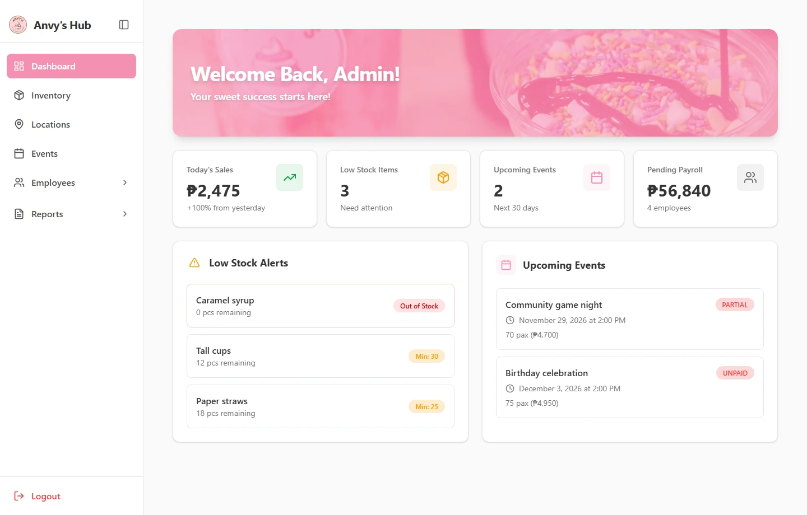

# Anvys Hub

Anvys Hub brings checkout, branch inventory, event bookings, and employee operations into one web app for small retail businesses with multiple locations.

Staff can record a sale, check stock, or clock in from the same workspace. Administrators can plan shifts, review attendance, and generate payroll from approved hours.



*Administrator dashboard with demo data from an earlier development build.*

## What you can do

| Workflow | Staff | Administrators |
| --- | --- | --- |
| Sales and stock | Customize products, record checkout payments, download receipts, and adjust stock. | Manage locations and inventory, review stock movements, and export sales and inventory reports. |
| Staffing and payroll | Clock in and out, and view published shifts. | Manage employee records, publish shifts, review attendance, and generate payroll and PDF payslips. |
| Events | | Schedule bookings, record deposits and payments, and export event reports. |

## How it works

Laravel 12 serves React 19 pages through Inertia 2. MySQL stores application data, and Vite builds the React and Tailwind CSS assets. Laravel sessions authenticate browser requests, and administrator routes also require the administrator role and a verified one-time code.

- **Checkout** saves the order and its line items in one transaction and attributes the sale to the signed-in cashier.
- **Attendance and payroll** use dedicated Laravel services to calculate worked hours and generate payroll and payslips from approved records.
- **Reporting** aggregates sales, stock, bookings, and payroll. The four report views also provide CSV exports.

See [Architecture](docs/ARCHITECTURE.md) for request flow, data relationships, and implementation details.

## Run locally

Start with PHP 8.4, Composer 2, a compatible Node.js version, and a fresh MySQL database. Use the [setup guide](docs/GETTING_STARTED.md) to set Composer's CA bundle path, copy `.env.example` to `.env`, and configure the database.

```sh
composer install
npm ci
php artisan key:generate
php artisan migrate --seed
composer run dev
```

Open [localhost:8000](http://localhost:8000). The guide covers demo sign-in, separate development commands, testing, and the container configuration.

## Current scope

Checkout records cash, card, and GCash payments taken at the counter. Inventory changes are recorded separately. Payroll uses the rules implemented in the application and requires review before use for real payroll.

The [known limitations](docs/ARCHITECTURE.md#known-limitations) cover location permissions and incomplete payroll screens.

## License

The repository declares the [MIT license](composer.json).
