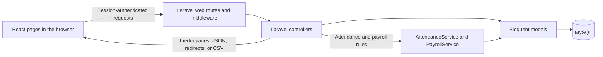
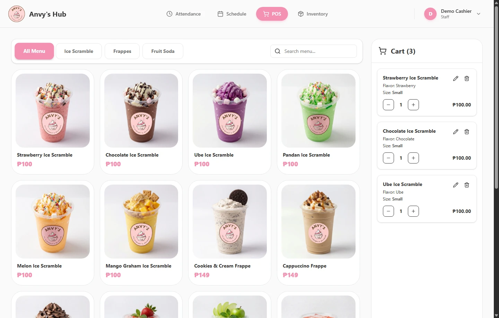

# Architecture

[Back to the README](../README.md) · [Getting started](GETTING_STARTED.md)

## Request flow

Laravel serves the initial [Blade shell](../resources/views/app.blade.php). [The React entry point](../resources/js/app.jsx) resolves the page named by Inertia to a component under [`resources/js/Pages/`](../resources/js/Pages). Inertia shares the signed-in user, employee and location context, and flash messages through [middleware](../app/Http/Middleware/HandleInertiaRequests.php). Vite handles asset compilation, and Ziggy makes Laravel's named routes available to the frontend.

## Route and permission boundaries

The [web routes](../routes/web.php) contain the application's browser endpoints.

| Boundary | Behavior |
| --- | --- |
| Sign-in and sign-out | Laravel authenticates email and password, regenerates the session on sign-in, and invalidates it on sign-out. Newly created employee accounts can set a password through a signed, expiring setup link. |
| Administrator workspace | Routes check the administrator flag and require MFA verification in the current session. This workspace covers the dashboard, employee administration, inventory, event bookings, payroll, and reporting, including an audit log. |
| Staff workspace | The route group requires a signed-in session. Staff use it for attendance, published schedules, POS, and inventory. Staff inventory listing uses the employee's location when assigned. |

Most forms use Inertia or Laravel redirects and validation feedback. [Order creation](../app/Http/Controllers/POSController.php) returns JSON for the receipt, [payroll calculation](../app/Http/Controllers/Admin/PayrollController.php) returns JSON for the preview, and [report exports](../app/Http/Controllers/ReportsController.php) stream CSV downloads. These endpoints share the browser session and Laravel's web middleware.

## Data relationships

The [migrations](../database/migrations) define the schema, and [Eloquent models](../app/Models) define the application relationships.

| Domain | Main relationships |
| --- | --- |
| Staff and locations | A user can have an employee profile. Employee profiles and shifts can reference a location. Shift and attendance records reference users. |
| Sales | Categories contain products. Products can have sizes and share add-ons. Orders reference the cashier and contain order items. |
| Inventory | Inventory items belong to locations. Stock logs record movements and can reference the user who made the adjustment. |
| Events | Each booking references a package and can have multiple recorded payments. The event model derives payment status from the payment total and booking price. |
| Payroll | A payroll run covers a date range and has individual payslips linked to users. Approved attendance supplies hours for the calculation. |
| Audit logs | Model events on users, employee profiles, and payroll runs create activity records visible from the administrator workspace. |

## Workflow details

### Checkout and reporting

*Staff POS with demo data from an earlier development build.*

Staff select products, sizes, and add-ons in the [POS page](../resources/js/Pages/staff/POS.jsx). The server validates the request, calculates the order subtotal from the submitted line totals, and saves the order and line items in one transaction. The browser uses the response to produce a downloadable receipt. The sales report reads stored orders and line items, and its location filter follows the cashier's employee profile. Stock changes are recorded through the inventory workflow.

### Attendance to payroll

1. Staff clock in and out. The controller checks the PIN when the account has one configured and checks the request IP when the employee's location has an allowed IP. [`AttendanceService`](../app/Services/AttendanceService.php) applies the configured break and overtime rules.
2. An administrator reviews attendance records and can approve, reject, or correct them.
3. [`PayrollService`](../app/Services/PayrollService.php) uses approved records for the selected period, counts distinct workdays, and calculates regular pay, overtime, and deductions. Generation creates a draft payroll and its payslips inside a transaction. Individual generation rejects overlapping payslips, and bulk generation skips employees who already have one in the selected period.
4. An administrator can download individual payslips from the payroll interface and mark the run as paid.

### Event bookings

Administrators book events from a calendar, select a package, and record payments against the booking. [Event payments](../app/Http/Controllers/EventPaymentController.php) are recorded in the application, and the [event model](../app/Models/Event.php) derives settlement status. Checkout and event payments record payment information for transactions handled outside the application.

## Known limitations

- Staff inventory listing uses the assigned location as a filter. The shared stock adjustment handler currently lacks a corresponding location check. Location assignments should be treated as operational grouping.
- The standalone payroll details route points to an unresolved Inertia page. Use the details modal in the payroll list. Contribution settings has a form, but its save route is absent.
- Payroll deductions include application-specific rules and a zero tax value. Any real payroll use requires review of the calculation and deductions.
